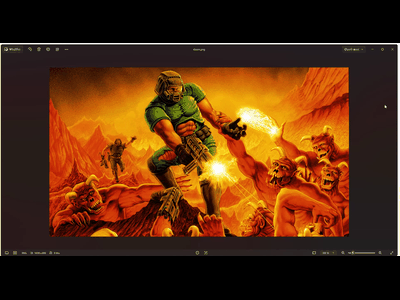

# DOOM Steg

[English](./README.md)

Une recréation de DOOM en Steg. L'image PNG embarque le programme complet ; les cartes et ressources audiovisuelles sont lues directement dans le WAD au lancement du jeu.



## Lancer le jeu

Utilisez Steg **0.0.3 ou plus récent**, qui contient les instructions audio et de rendu utilisées par cette démo.
Depuis la racine du dépôt, avec `steg` dans le PATH :

```shell
cd examples/doom
steg run_img doom.png
```

Le dossier contient :

| Fichier | Rôle |
| --- | --- |
| [doom.png](./doom.png) | Image contenant le programme Steg compilé. |
| [doom.steg](./doom.steg) | Source complet et autonome, avec le lecteur WAD. |
| [DOOM.wad](./DOOM.wad) | Le WAD Ultimate DOOM de la démo : quatre épisodes, 36 cartes avec les niveaux secrets. |

Le programme ouvre le chemin relatif exact `DOOM.wad` dans le **dossier depuis lequel il est lancé**, pas nécessairement à côté de l'image. Respectez la casse du nom sous Linux.
Sous Windows, vous pouvez aussi placer `steg.exe` dans ce dossier et lancer `steg.exe run_img doom.png`.

Aucun pack de ressources, script d'extraction, lecteur audio externe ou autre fichier de jeu n'est nécessaire. Le jeu crée ses paramètres et sauvegardes dans le dossier de lancement si besoin.

Le premier chargement d'une carte prépare ses ressources depuis le WAD et peut prendre un moment. Les niveaux suivants sont préparés à la demande, en conservant la dernière image affichée et un indicateur de progression pendant le chargement.

## Commandes

| Action | Touche / souris |
| --- | --- |
| Avancer / reculer | Z ou W / S ; flèches Haut / Bas |
| Déplacement latéral gauche / droite | Q ou A / D |
| Tourner | Souris ; flèches Gauche / Droite |
| Courir | Maintenir Maj |
| Tirer | Clic gauche ou Ctrl |
| Utiliser portes, boutons et ascenseurs | E ou Espace |
| Choisir une arme | 1–7, après l'avoir récupérée |
| Carte | Tab ou M |
| Pause / reprendre | Échap |
| Revenir au menu principal | Échap, sélectionner **END GAME**, puis Entrée |
| Fermer le jeu | Sélectionner **QUIT GAME** |
| Recommencer après la mort | Espace ; un message rappelle la touche à l'écran |
| Menu sauvegarde / chargement | F6 / F9 |
| Plein écran | F11 |
| Afficher les FPS | F10 |
| Détail du rendu | F2, ou Options |
| Couper / rétablir le son | F7 |

La sensibilité de la souris, le volume et le détail du rendu sont réglables dans **Options**.
La souris tourne horizontalement, avec les déplacements classiques ; le saut et la visée verticale à la souris ne sont pas activés.

## Lancer ou recompiler le source

Depuis ce dossier :

```shell
steg run doom.steg
steg build doom.steg doom.png doom-custom.png
steg run_img doom-custom.png
```

L'image existante peut servir de support pour recompiler. Le source `.steg` n'a ni imports ni chemins propres à une machine.

## Périmètre

Il s'agit d'une recréation en Steg, pas de l'exécutable C original. Elle comprend les quatre épisodes de DOOM, le choix de la difficulté, les combats, les actions décrites dans le WAD, les décors animés, les sauvegardes et l'audio natif. Elle ne comprend pas le multijoueur ni la campagne de Doom II.

Le WAD fourni et les illustrations DOOM sont des ressources du jeu d'id Software, distinctes du code du langage Steg.
