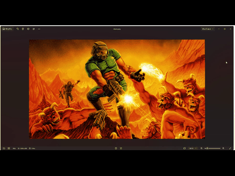

# DOOM Steg

[Français](./README.fr.md)

A recreation of DOOM in Steg. The PNG embeds the complete game program; maps and audiovisual resources are read directly from the accompanying IWAD at runtime.



## Run

Use Steg **0.0.3 or newer**, which includes the audio and raster instructions used by this demo.
From the repository root, with `steg` on your PATH:

```shell
cd examples/doom
steg run_img doom.png
```

The directory contains:

| File | Purpose |
| --- | --- |
| [doom.png](./doom.png) | Image containing the compiled Steg program. |
| [doom.steg](./doom.steg) | Complete, standalone source, including the WAD reader. |
| [DOOM.wad](./DOOM.wad) | The demo's Ultimate DOOM IWAD: four episodes, 36 maps including secret maps. |

The program opens the exact relative path `DOOM.wad` in the **working directory**, rather than next to the image. Keep that filename's casing on Linux.
On Windows, you can also put `steg.exe` in this directory and launch `steg.exe run_img doom.png`.

No resource pack, extraction script, external audio player or additional game files are required. The program creates its settings and save files in the working directory when needed.

The first load of a level prepares resources directly from the WAD and may take a moment. Later levels are prepared on demand, with the previous frame and a progress indicator retained during loading.

## Controls

| Action | Key / mouse |
| --- | --- |
| Forward / backward | W or Z / S; Up / Down arrows |
| Strafe left / right | A or Q / D |
| Turn | Mouse; Left / Right arrows |
| Run | Hold Shift |
| Fire | Left mouse button or Ctrl |
| Use doors, switches and lifts | E or Space |
| Select weapon | 1–7, once acquired |
| Automap | Tab or M |
| Pause / resume | Escape |
| Return to main menu | Escape, select **END GAME**, then Enter |
| Close the application | Select **QUIT GAME** |
| Restart after death | Space; the on-screen prompt reminds you |
| Save / load menu | F6 / F9 |
| Fullscreen | F11 |
| FPS display | F10 |
| Rendering detail | F2, or Options |
| Mute / unmute audio | F7 |

Mouse sensitivity, volume and rendering detail are adjustable in **Options**.
The game uses horizontal mouse turning and the original movement style; jumping and vertical mouse look are not enabled.

## Run or rebuild the source

From this directory:

```shell
steg run doom.steg
steg build doom.steg doom.png doom-custom.png
steg run_img doom-custom.png
```

The existing PNG can serve as the carrier when rebuilding. The `.steg` source has no imports or machine-specific paths.

## Scope

This is a Steg recreation, not the original C executable. It implements the four DOOM episodes, difficulty selection, combat, WAD-driven actions, animated environments, saves and native audio. It does not implement multiplayer or Doom II's campaign.

The included IWAD and DOOM artwork are id Software game resources, distinct from the Steg language source.
